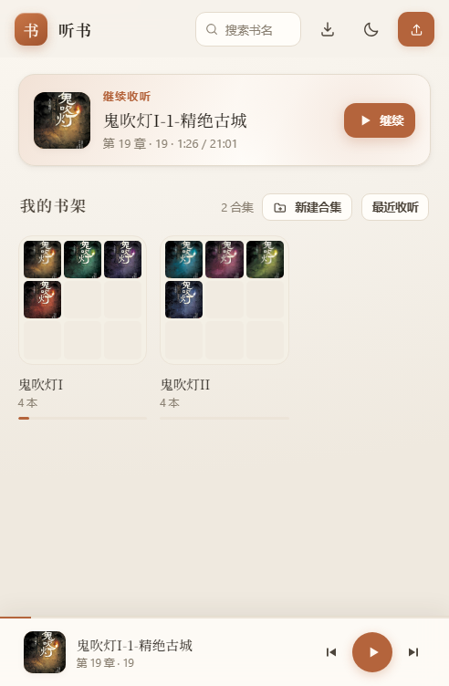

# 听书 · 局域网有声书书架

路由器上装一个 ipk，U 盘里的有声书就变成一个网页书架：手机、平板、电脑用浏览器打开就能听，不用装 App、不用上传文件。
另带一个原生安卓客户端，连同一个服务，账号、进度、合集、暂停记录多端对齐。

面向的场景是「自己家里用」：局域网内多设备、多账号，音频留在自己的硬盘上。

```
浏览器 / 安卓 App
      │  HTTP
      ▼
uhttpd(:8686) ──► /tmp/tingshu/www        网页本体 + library.json（每次启动重建）
      │          ├─► /cgi-ts/*            账号、进度、合集、元数据、书库管理
      │          └─► /tmp/tingshu/www/media ──软链──► 书架目录（音频与封面）
      │
      └─ scan.sh 扫描书架目录生成索引；用户数据写在 /etc/tingshu（overlay，重启不丢）
```



## 特性

**听**

- 断点续播、±30 秒、0.5×–3× 倍速
- 定时关闭：15–90 分钟或「播完本章」，分钟定时可勾选「到点后听完本节」
- 后台 / 锁屏继续播放，自动预取下一章，播完无缝续下一集
- 暂停记录：手动暂停、开启定时、定时到点都会记一笔，可跳转续播、单条删除、清空

**管**

- 每个子文件夹一本书，文件夹名即书名；音频按文件名自然排序（`02` 在 `10` 前面）
- 封面可自动识别（`cover.jpg`、`folder.png`、`front`、`poster`、`封面` 这类文件名），也可上传图片自由缩放裁切，或直接挑一套配色
- 上传整文件夹或 `zip` / `tar.gz`：在浏览器里解压，中文名不会乱码；选中「装着多本书的父目录」会自动剥掉外层
- 书名、简介、封面、合集同步到服务器，各端共用同一套

**人**

- 多用户：管理员建号、重置密码、删号；至少保留一个管理员
- 普通用户只能听书，管理入口（上传 / 编辑 / 删除 / 重扫 / 用户管理）对普通用户隐藏，服务端也会拒绝
- 每个账号独立保存：听书进度、合集、暂停记录、每行显示列数

**端**

- 网页：零依赖单页应用，无构建、无第三方库，手机 / 平板 / 桌面自适应，日间 / 夜间主题
- 安卓：Kotlin + Jetpack Compose + Media3，功能与网页版对齐，详见 [android/README.md](android/README.md)

## 快速开始

### 1. 装到路由器

从 [Releases](https://github.com/LyricsGod/luci-app-tingshu/releases) 下载 `luci-app-tingshu_<版本>-<release>_all.ipk`，传到路由器：

```sh
opkg update
opkg install /tmp/luci-app-tingshu_1.5.0-1_all.ipk
```

装完自动启用并启动服务，打开 LuCI 的 **服务 → 听书** 配置。依赖 `uhttpd` 和 `luci-base`，正常装了 LuCI 的固件都有。

### 2. 放书

```
/mnt/audiobooks/
├── 三体/
│   ├── 01 地球往事.mp3
│   ├── 02 红岸之谜.mp3
│   └── cover.jpg          ← 可选，自动当封面
└── 明朝那些事儿/
    └── 01 洪武大帝.mp3
```

支持 mp3 / m4a / m4b / aac / ogg / oga / opus / wav / flac / webm。
`ape` / `wma` 允许上传，但浏览器能否播放取决于它自带的解码器。

> 手动往 U 盘里加完书，在 LuCI 里点一次「重新扫描书库」，或在网页里上传（上传后会自动重扫）。

### 3. 打开网页

浏览器访问 `http://路由器IP:8686/`。

第一次打开会让你创建管理员账号；之后用管理员或管理员创建的账号登录。点书 → 点章节即可开始听。

### 4. 安卓 App

从 [Releases](https://github.com/LyricsGod/luci-app-tingshu/releases) 下载 `tingshu-android-<版本>.apk`（Android 8.0+）安装，第一次打开：

1. 手机连上与路由器同一个 Wi-Fi
2. 地址默认预填 `192.168.2.1:8686`，换路由器可直接改，或点「扫描局域网」自动发现
3. 服务器还没有账号时，填用户名密码点「连接并登录」会直接创建管理员
4. 之后正常登录 → 点书 → 点章节

> 管理员在设置 → 用户管理里建用户；普通用户看不到上传 / 编辑 / 删除入口。

### 不用路由器？

网页是纯静态的，起个静态服务器就能用「本机文件夹」模式（没有服务器书库与多端同步）：

```sh
python -m http.server 8765     # 打开 http://127.0.0.1:8765
```

Windows 也可以双击 `启动听书.bat`（会自动挑 `python` 或 `py -3`）。

## 配置

LuCI → 服务 → 听书：

| 项 | 默认 | 说明 |
|---|---|---|
| 启用服务 | 开 | 关掉即停止监听 |
| 网页端口 | `8686` | 浏览器访问 `http://路由器IP:端口/` |
| 书架目录 | `/mnt/audiobooks` | 每个子文件夹是一本书；改完保存会自动重启服务 |

改完配置会重启 uhttpd 实例，几秒后刷新页面即可。

## 接口

所有接口都在 `/cgi-ts/` 下，返回 JSON；除 `library.json` 和 `media/*` 外都需要登录（cookie 或 `Authorization: Bearer`）。

| 接口 | 方法 | 说明 |
|---|---|---|
| `library.json` | GET | 书库索引（由 `scan.sh` 生成） |
| `media/<路径>` | GET | 音频与封面，指向书架目录 |
| `cgi-ts/auth` | GET / POST | `status` / `setup` / `login` / `logout` / `password` |
| `cgi-ts/users` | GET / POST | 列表 / `create` / `reset` / `delete`（管理员） |
| `cgi-ts/layout` | GET / POST | 每行列数，按账号存 |
| `cgi-ts/progress` | GET / POST | `?b=<hex>` 取单本；全量取所有；POST 写一本 |
| `cgi-ts/meta` | GET / POST | 书名 / 简介 / 配色 / 封面（封面为 base64），写需管理员 |
| `cgi-ts/collections` | GET / POST | 整个合集列表读写 |
| `cgi-ts/pausemarks` | GET / POST | 整个暂停记录列表读写 |
| `cgi-ts/manage` | POST | `upload` / `archive` / `delete` / `rescan`（管理员） |

书籍 id 统一用 `net:<文件夹名>`，同步接口里传它的 UTF-8 十六进制（如 `net:三体` → `6e65743ae4b889e4bd93`），服务端只接受 `[0-9a-f]`，天然免疫路径穿越。

## 数据在哪

| 数据 | 位置 | 重启后 |
|---|---|---|
| 静态页面 + 索引 | `/tmp/tingshu/www/` | 重新从 `/usr/share/tingshu/www` 复制、重扫 |
| 账号 | `/etc/tingshu/users/<用户名>/account` | 保留 |
| 听书进度 | `/etc/tingshu/users/<用户名>/progress/<hex>.json` | 保留 |
| 合集 / 暂停记录 / 布局 | `/etc/tingshu/users/<用户名>/*.json` | 保留 |
| 书名 / 简介 / 封面 | `/etc/tingshu/meta/<hex>.json`（全局共享） | 保留 |
| 登录会话 | `/tmp/tingshu-sessions/<token>` | 失效，需重新登录 |

`/etc/tingshu` 在 overlay 上，升级固件前记得备份；进度也可以在网页顶栏的下载图标里导出成 JSON。

## 开发

### 目录结构

```
index.html / app.js / styles.css     网页本体（零依赖、无构建）
manifest.webmanifest / icon.svg      PWA 图标与清单
build_ipk.py                         不依赖 OpenWrt SDK 的打包脚本
test/web-smoke.cjs                   网页端冒烟测试（jsdom）
openwrt/
  Makefile                           包 Makefile（SDK 用）
  files/                             装进路由器的文件
    etc/config/tingshu               UCI 配置
    etc/init.d/tingshu               procd 服务（起独立 uhttpd 实例）
    etc/uci-defaults/…               首次安装补默认值并启动
    usr/lib/tingshu/scan.sh          扫描书架目录生成 library.json
    usr/lib/tingshu/http.sh          CGI 公共函数（响应头、参数、原子写入）
    usr/lib/tingshu/auth.sh          用户 / 会话 / 鉴权
    usr/lib/tingshu/api/*            8 个 CGI：auth users layout progress meta
                                     collections pausemarks manage
  htdocs/…/view/tingshu/main.js      LuCI 管理页
  src/www/                           打包时从根目录同步过来的网页副本
android/                             安卓客户端（Kotlin + Compose + Media3）
  app/src/main/java/com/tingshu/app/
    data/                            HTTP 客户端、书库、进度、封面缓存、局域网扫描
    playback/                        Media3 播放服务
    ui/                              Compose 界面与状态
  app/src/test/                     纯 JVM 单测（34 个，协议与服务端对齐）
```

### 常用命令

| 任务 | 命令 |
|---|---|
| 本地预览网页 | `python -m http.server 8765` 或双击 `启动听书.bat` |
| 网页冒烟测试 | `npm install`（仅首次）→ `npm test` |
| 打包 ipk | `python3 build_ipk.py`（产物在 `dist/`） |
| 用 SDK 打包 | `cp -r openwrt package/luci-app-tingshu && make package/luci-app-tingshu/compile V=s` |
| 构建 APK | `cd android && ./gradlew assembleRelease` |
| 安卓单测 | `cd android && ./gradlew testDebugUnitTest` |

没有 JDK / SDK 也能打 ipk；APK 需要 JDK 17 + Android SDK 34（`compileSdk = 34`）。

### 版本号

网页与 ipk 的版本号只有一个来源：`app.js` 里的 `APP_VERSION`，`build_ipk.py` 直接读它。
安卓的版本号在 `android/app/build.gradle.kts`（`versionCode` / `versionName`）。三处要一起改，CI 会校验它们是否一致。

### 网页副本

`openwrt/src/www/` 是根目录网页文件的副本（ipk 里打的是这一份）。`python build_ipk.py` 会自动同步，也可以 `npm run sync:www`；CI 会检查两边是否一致。

### CI

`.github/workflows/build.yml`：

- **check**：全部 JS / shell / Python 语法、JSON 合法性、网页副本一致性、版本号一致性、CRLF 检查、网页冒烟测试
- **package**：打包 ipk 并校验包结构
- **android**：跑单测 + 打 APK

推送到 `main` 触发上面三步；打 `v*` 标签会额外把 ipk / APK 发到 Release。

## 已知限制

- 进度时间戳用各设备自己的时钟，多台设备都正常对时即可
- zip 在浏览器 / App 里解压（路由器上的 unzip 会把中文名转成 GBK），网页端需要 Chrome 80+ / Edge / Safari 16.4+
- 服务只监听局域网，WAN 侧由防火墙挡住；外网访问建议走 VPN 或反向代理
- 安卓 APK 用 debug 签名（自用足够）；部分国产 ROM 需要手动允许「后台运行 / 自启动」
- 只支持 HTTP，没有 HTTPS（局域网自用足够）

## License

MIT
