# 听书 · Android 客户端

原生安卓客户端：Kotlin + Jetpack Compose（Material 3）+ Media3（ExoPlayer / MediaSession）。
连的是 OpenWrt 上的 `luci-app-tingshu` 服务，**功能和网页版保持一致**：账号登录、书架与合集（九宫格封面）、
搜索排序、每行显示列数、上传/删除书籍、编辑书名/简介/方形封面（可自由裁切）、进度备份恢复、暂停记录、
倍速/定时/后台播放。同一账号的进度、合集、暂停记录、布局都和网页端双向同步；不同账号互相独立。

## 截图

| 书架 | 书籍详情 | 播放器 | 裁切封面 |
|:--:|:--:|:--:|:--:|
| 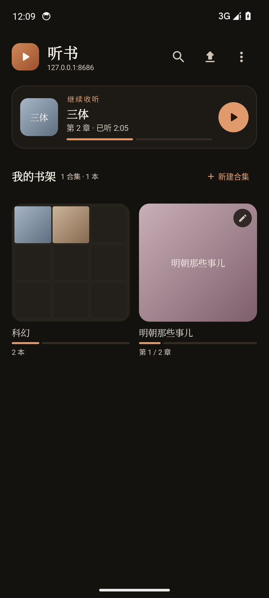 | 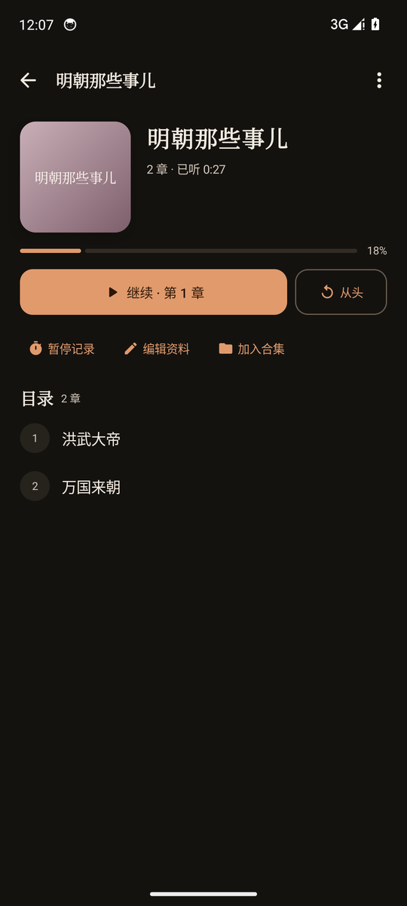 | 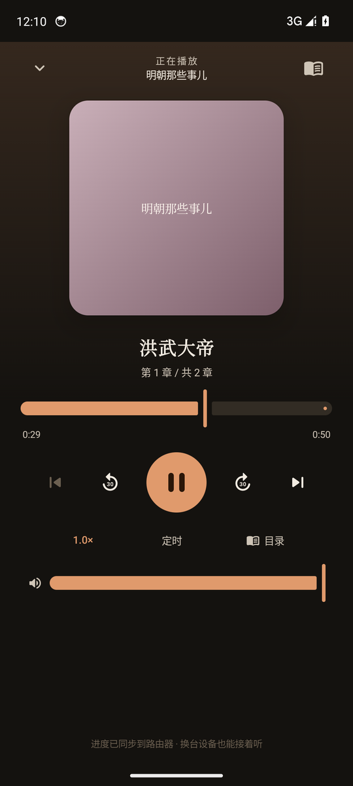 | 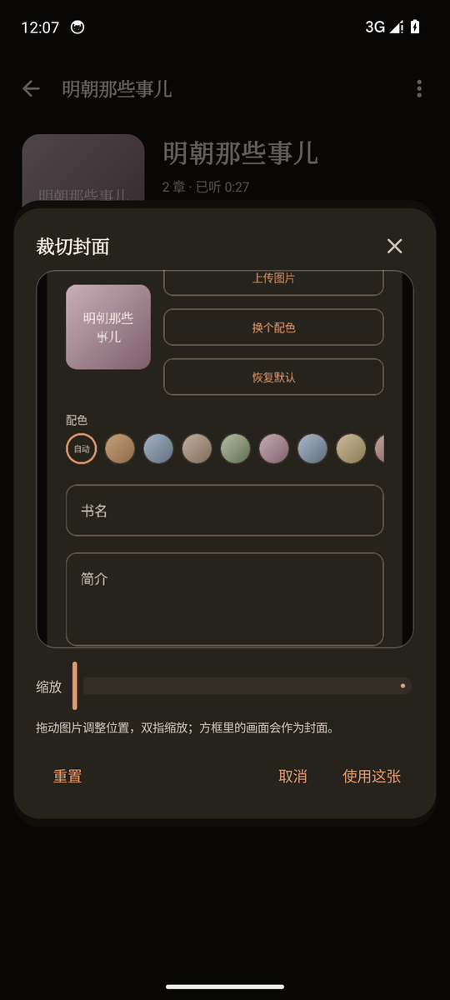 |

| 登录 / 建管理员 | 用户管理 | 首页列数 |
|:--:|:--:|:--:|
| 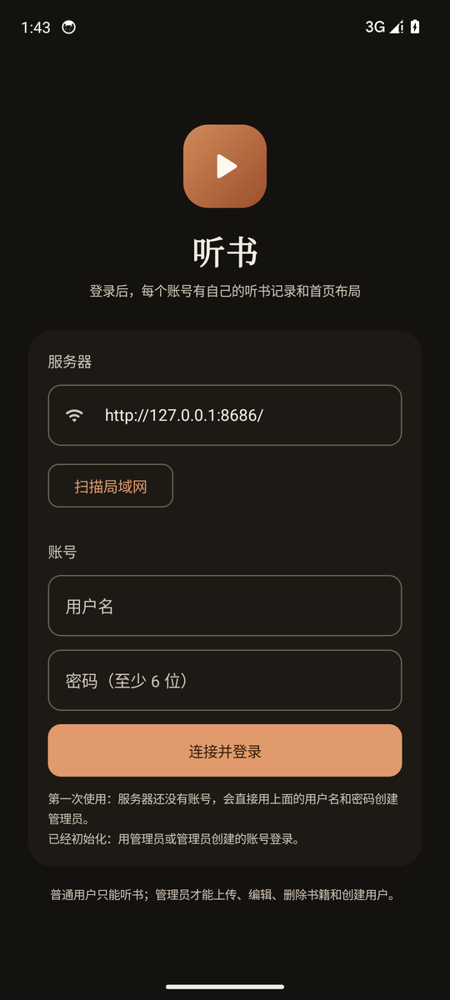 | 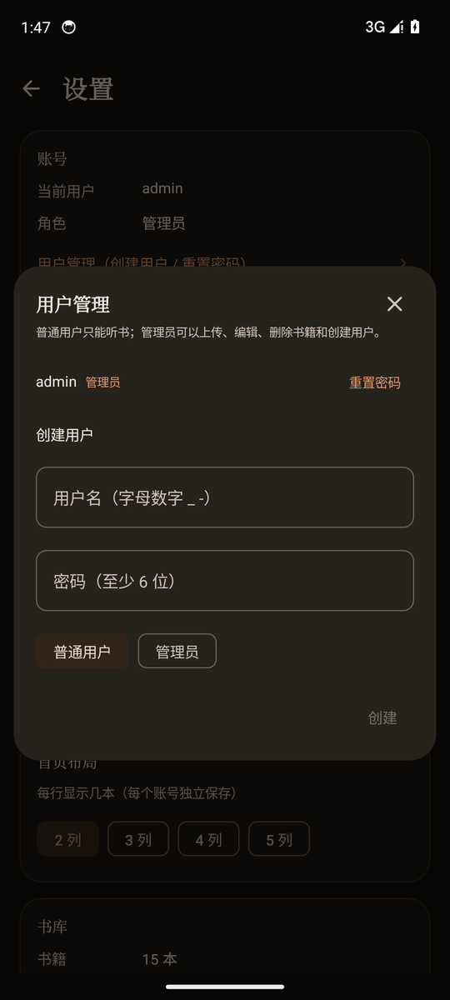 | 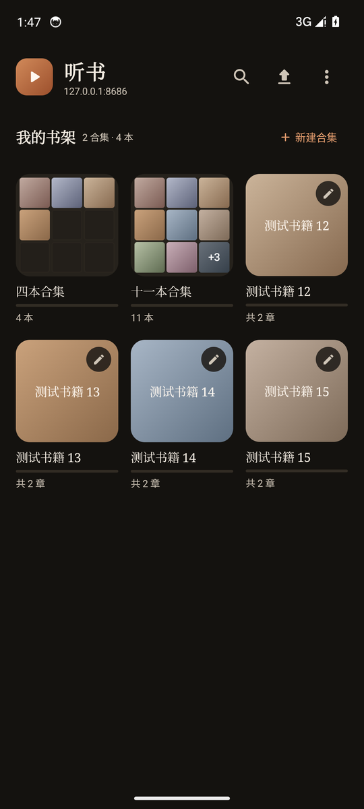 |

| 编辑书籍 | 暂停记录 | 上传书籍 | 设置 |
|:--:|:--:|:--:|:--:|
| 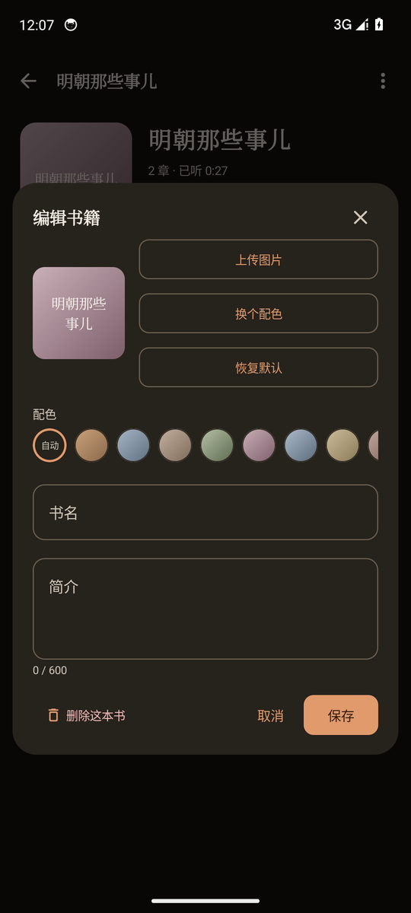 | 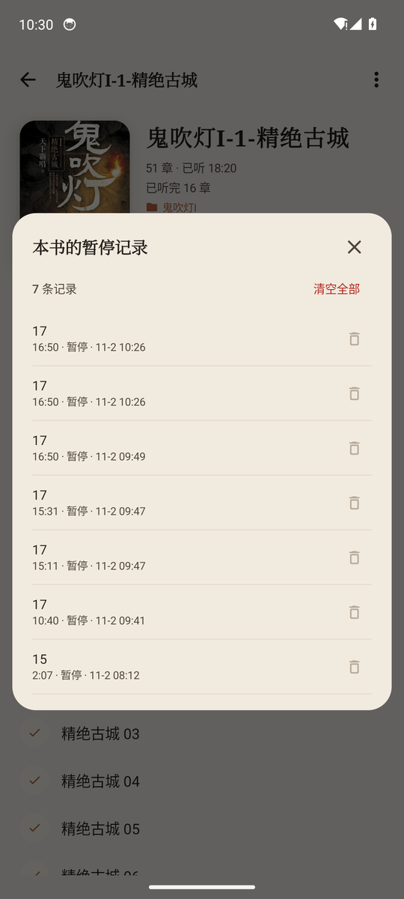 | 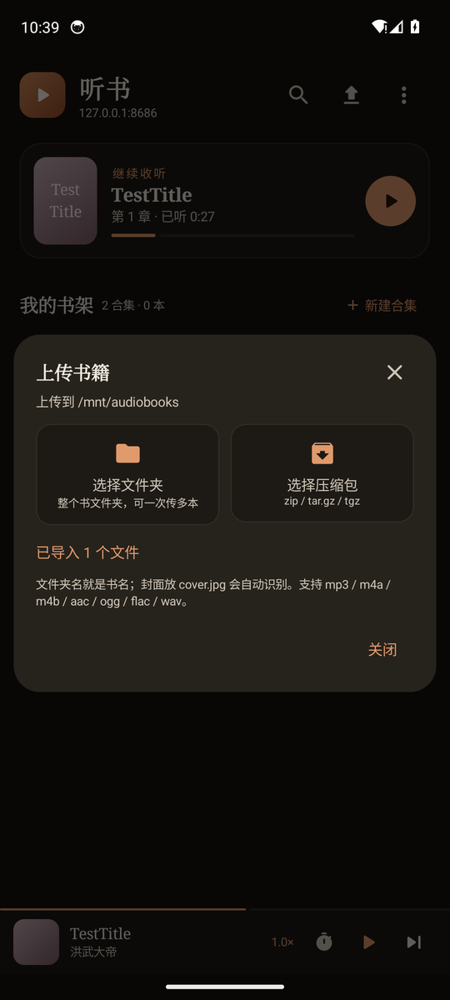 | 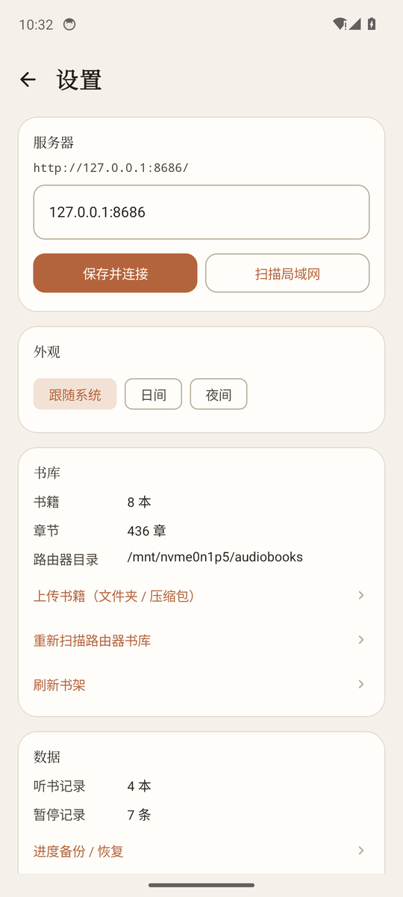 |

## 功能

- **多用户**：首次使用创建管理员；管理员可创建普通用户/管理员、重置密码、删除用户；每个账号独立保存进度、合集、暂停记录和布局
- **权限**：普通用户看不到上传、编辑、删除、重扫、用户管理入口；服务端也会拒绝这些请求
- **书架**：合集卡片（3×3 九宫格封面）、继续收听、搜索书名/合集、三种排序（最近收听 / 书名 / 进度）
- **布局**：设置里可选每行 2/3/4/5 列，按账号保存，平板/手机都适用
- **合集**：新建、改名、增删书、调整顺序、删除；一本书只属于一个合集，已收进合集的书不在书架上重复出现
- **书籍**：章节列表（正序/倒序切换、右侧拖动条快速定位）、已听完标记、简介、合集入口；封面统一 1:1 方形；编辑书名/简介/配色/封面，删除整本书
- **封面裁切**：选图后可双指缩放、拖动位置，方框内画面输出 720×720 JPEG；网页端和 App 行为一致
- **上传**：选整个文件夹（保留目录结构，自动剥掉「装着多本书的大文件夹」外层）或 zip / tar.gz / tgz
  （手机端自己解压，避免路由器 unzip 把中文名转成 GBK）
- **播放**：断点续播、拖动进度、±30 秒、上一章/下一章、0.5×–3× 倍速、音量、定时关闭
  （15/30/45/60/90 分钟或「本章播完后暂停」；分钟定时可勾选「到点后播完本集再暂停」）、后台/锁屏播放、通知栏与耳机按键；通知栏和锁屏封面就是书籍封面
- **暂停记录**：手动暂停、开启定时、定时到点都会记一笔；支持跳转续播、单条删除、清空；每条前面有小图标标出来源（手机 = 移动端，显示器 = 网页端）
- **进度备份**：导出/导入 JSON，格式和网页端一致；导入按 `updatedAt` 取较新的一份
- **主题**：跟随系统 / 日间 / 夜间（应用内切换，状态栏和导航栏一起变）
- **局域网扫描**：自动探测同网段 `8686` 端口上的听书服务

## 构建

需要 JDK 17 和 Android SDK 34；仓库自带 Gradle wrapper（8.9）。

```sh
cd android
./gradlew assembleRelease       # 产物：app/build/outputs/apk/release/app-release.apk
./gradlew testDebugUnitTest     # 纯 JVM 单元测试
```

也可以直接用 Android Studio 打开 `android/` 目录。minSdk 26（Android 8.0），targetSdk 34。

Release 用仓库内固定的证书签名（`android/keystore/tingshu-release.jks`，配置在 `keystore.properties`）。
本地和 CI 共用同一把钥匙，所以新版本可以直接覆盖安装升级；要上架应用商店请换成自己的 keystore，
并改成从环境变量 / GitHub Secrets 读取密码。

> 首次打开预填的地址是 `192.168.2.1:8686`，在 `ui/screens/SetupScreen.kt` 顶部的 `DEFAULT_SERVER` 里改。

## 目录结构

```
app/src/main/java/com/tingshu/app/
├─ TingshuApp.kt             Application + 手写依赖容器
├─ MainActivity.kt           单 Activity + Compose + 主题
├─ data/
│  ├─ TingshuApi.kt          library.json / cgi-ts/* 的 HTTP 客户端（含流式上传）
│  ├─ LibraryRepository.kt   书库 + meta + 合集 → UI 模型
│  ├─ Models.kt / Hex.kt / Urls.kt / Names.kt / BookStats
│  ├─ ProgressStore.kt       本机进度缓存
│  ├─ CollectionsStore.kt    合集缓存
│  ├─ PauseMarksStore.kt     暂停记录缓存
│  ├─ CoverStore.kt          meta 里的 base64 封面 → 私有目录
│  ├─ AppPrefs.kt            服务器 / 倍速 / 音量 / 主题 / 排序
│  ├─ ArchiveImporter.kt     zip / tar.gz 解包（commons-compress）
│  ├─ UploadPaths.kt         上传白名单、路径规范化、剥外层目录
│  ├─ ProgressBackup.kt      进度 JSON 导入导出
│  └─ LanScanner.kt          /24 网段探测 8686
├─ playback/
│  ├─ PlaybackService.kt     MediaSessionService + ExoPlayer
│  ├─ PlaybackController.kt  界面 ↔ 服务：状态流、章节切换事件
│  └─ PlayerUiState.kt
└─ ui/
   ├─ TingshuRoot.kt         路由 + 迷你播放器 + 通知权限
   ├─ TingshuViewModel.kt    书库/进度/合集/暂停记录/上传/备份/播放
   ├─ theme/                 Material 3 配色、字体、系统栏
   ├─ components/            封面、合集宫格、迷你播放器、统计
   ├─ dialogs/               编辑书籍、封面裁切、合集管理、上传、备份、暂停记录、用户管理
   └─ screens/               Auth / Library / Collection / Book / Player / Settings
```

## 和服务端的约定

| 用途 | 接口 | 说明 |
|---|---|---|
| 登录/初始化 | `GET/POST cgi-ts/auth` | status / login / setup；返回 token，同时写 HttpOnly cookie |
| 用户管理 | `GET/POST cgi-ts/users` | 仅管理员；create / reset / delete |
| 书库 | `GET library.json` | 服务端扫描生成的索引（共用） |
| 音频 | `GET media/<路径>` | 路径按 `encodeURIComponent` 逐段编码（共用） |
| 进度 | `GET/POST cgi-ts/progress` | POST 表单 `b/i/t/d/u`；按登录用户隔离 |
| 书名/简介/封面 | `GET/POST cgi-ts/meta` | 键是书 id 的十六进制；封面 base64；POST 仅管理员 |
| 合集 | `GET/POST cgi-ts/collections` | POST `c=<urlencoded JSON 数组>`；按用户隔离 |
| 暂停记录 | `GET/POST cgi-ts/pausemarks` | POST 整个 JSON 数组；按用户隔离 |
| 页面布局 | `GET/POST cgi-ts/layout` | JSON `{"columns":2-5}`；按用户隔离 |
| 上传/删除/重扫 | `POST cgi-ts/manage?action=...` | 仅管理员；upload 流式 POST 文件；archive 交服务端解压；delete/rescan |

必须和网页端严格对齐的点：

- **登录**：App 保存登录返回的 token，同时放进 `Cookie: tingshu_session=...` 和 `Authorization: Bearer ...` 发送（uhttpd 对这两种支持最稳）；网页用 HttpOnly cookie。
- **书 id**：`net:<文件夹名>`（散装音频 `net:__root__`），进度/元数据的键是它的 UTF-8 十六进制。
- **进度合并**：两边都有记录时按 `updatedAt` 取新的；两边都是空记录就跳过。
- **done**：只有自动播完（`MEDIA_ITEM_TRANSITION_REASON_AUTO`）或整本播完才记该章已完成。
- **合集**：一本书只能在一个合集里；服务端数组是权威来源，本地改动合并后 400ms 防抖推送。
- **暂停记录**：`pause` / `timer` / `timer-start` 三种原因 + `source`（`app` / `web`，旧记录为空）；推送前先拉服务器合并，连同删除墓碑 `removed` 一起写回，避免覆盖另一端的记录。
- **封面**：选图后在 App/网页里自由缩放、拖动裁切，输出 720×720 JPEG（质量 86），方框内即所见。
- **上传结构**：文件夹名就是书名；选中的如果是「装多本书的父目录」，和网页一样剥掉外层；
  `CD1/光盘1/第N卷` 这类分盘目录不剥。

## 已知限制

- 只支持局域网 HTTP（`usesCleartextTraffic=true`）；外网访问请走 VPN 或反向代理。
- Android 13+ 需要授予通知权限才会显示播放通知；部分国产 ROM 还要手动允许后台运行/自启动。
- 播放列表里的封面只用 `artworkUri`，不把 base64 塞进每条 MediaItem，避免 Binder 事务超限。
- 当前版本号 1.6.3，APK 用仓库内的固定证书签名（可直接覆盖升级）。

## 测试

`app/src/test/` 下是纯 JVM 测试，不依赖模拟器（34 个）：

- `TingshuApiTest`：本地 HTTP 服务模拟 uhttpd，覆盖书库、meta（含推送）、进度、合集（含推送）、
  暂停记录（含推送）、重扫、文件上传、删除。
- `HexTest`：`net:三体` → `6e65743ae4b889e4bd93`，和网页端 `hexOf()` 完全一致。
- `UrlsTest`：地址归一化、反向代理子路径、`encodeURIComponent` 规则。
- `NamesTest`：自然排序、章节标题清洗。
- `UploadPathsTest`：剥外层目录、分盘目录、路径规范化、上传白名单。
- `ProgressBackupTest`：备份格式、导入解析、坏字段过滤。
